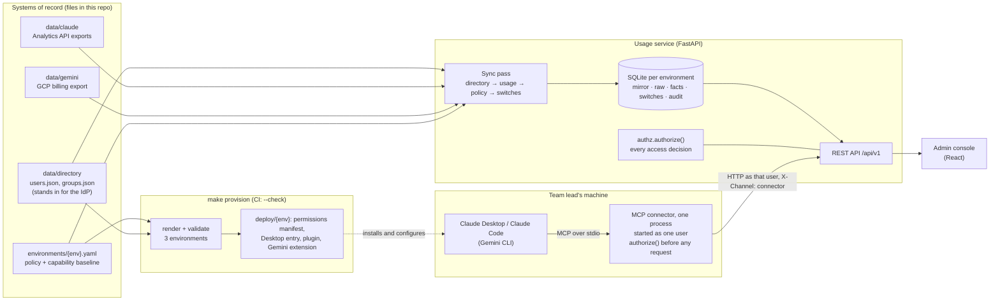

# Meridian AI usage service

Assignment ID: **Fullstack-ClaudeGemini-UsageConnector-v1**

Meridian runs its staff AI assistant on both Claude and Gemini. This service combines the two platforms' usage exports into one model, shows usage and cost by platform, group and week, and lets platform owners switch capabilities on or off per group, with roles deciding who may see and change what. An MCP connector brings the same information into the assistant, so a team lead can ask Claude "how much did my team use last month?" and see only their own team.

> **Status:** Parts A and B are built and tested (`make check` green: 226 tests, `provision --check` up to date). Still to do by me:
> - commit Part B, push, and tag `v0.2.0`: the host configs pin that tag, and the plugin marketplace installs from GitHub
> - the screen recording in Claude Desktop ([script](docs/demo/RECORDING.md))
> - my own check of the admin console in a browser (Chloe, Priya, Daniel in prod)
> - rewrite the sections marked *draft* in my own words

**Built for Claude**: registered in Claude Desktop as a local MCP server and packaged as a Claude plugin with a marketplace. The same connector is also packaged as a Gemini CLI extension (rendered and validated, not run in Gemini CLI).

---

## Quick start

Requires [uv](https://docs.astral.sh/uv/) and Node 20.19+ or 22.12+ (Vite 8).

```bash
make setup                 # backend (uv sync) and frontend (npm ci) dependencies
make run                   # API for dev on :8000; APP_ENV=prod make run serves prod on :8002
make dev-web               # admin console on http://localhost:5173 (APP_ENV picks which API)
make check                 # everything CI runs: lint, format, strict types, tests, build, provision --check
```

The connector and its configuration:

```bash
make provision             # render + validate permissions and host config for dev, staging, prod
make demo-transcript       # the connector over stdio against a fresh prod service -> docs/demo/transcript.md
make register-desktop ENV=prod AS=user_E7691888F28227066DD2FB86 SOURCE=local   # Claude Desktop, as Priya
```

On start, the server syncs the directory, ingests the exports under `data/`, and seeds the capability switches. One SQLite database per environment lives in `var/<env>.db`. To run the same sync without the server:

```bash
cd backend && APP_ENV=prod uv run meridian sync
```

In the console, pick a person from the switcher (identity is simulated) and the page shows what that person may see. Good ones to compare in prod: **Chloe Dubois** (platform admin), **Priya Nair** (team lead, Clinical Operations), **Daniel Okafor** (member).

The API is self-documented at http://localhost:8000/docs. Every request except the health, periods and directory endpoints needs an `X-User-Id` header carrying a directory `user_id`:

```bash
curl -s "localhost:8000/api/v1/usage/summary?period=last_30_days" \
     -H "X-User-Id: user_E7691888F28227066DD2FB86"      # Priya: her own group only
```

---

## Repository layout

```
data/            starter-kit exports and directory (drop new or corrected files here)
environments/    dev / staging / prod policy and host settings: the provisioning inputs
contracts/       the four tools' contract: the connector serves it verbatim; the API is tested against it
backend/         FastAPI service and the MCP connector (Python 3.13, one package)
  app/           api/ routes, core/ config and policy, services/ ingestion and authz, repositories/ SQL
    connector/   MCP server: startup checks, the four tools, HTTP client to the service
    provisioning/  render + validate per-environment config, Claude Desktop registration
  database/      timestamped SQL migrations and the table conventions
  tests/         unit, integration and connector tests
frontend/        React admin console (Vite, TypeScript)
deploy/          GENERATED per environment: permissions manifest, Claude Desktop entry, Claude plugin, Gemini extension
.claude-plugin/  GENERATED plugin marketplace listing the three environments' plugins
.github/         CI: make check, then Claude Code's own plugin validator
docs/            plans, decisions log (D1–D52), AI usage log, demo transcript, note to team leads
```

---

## Architecture



**How data flows.** A *sync pass* runs at startup (or with `meridian sync`) and is recorded as a `sync_run`. Every file it takes in becomes a `source_file` row, identified by its SHA-256, so an unchanged file is skipped and any number can be traced back to the file it came from. The order matters:

1. **Directory.** `users.json` and `groups.json` are validated together and mirrored into read-only tables. People missing from a newer snapshot are deactivated, not deleted, so their past usage keeps pointing at them.
2. **Usage.** Each export record is stored verbatim in a raw table, then turned into rows of one unified table, `usage_fact`. Only the days a new file touched are rebuilt. A directory change rebuilds every day, because attribution depends on it.
3. **Policy.** The environment's YAML is validated (an invalid file stops the server) and recorded, so every switch change can name the policy version it happened under.
4. **Switches.** Any group × capability switch that doesn't exist yet is created from the YAML's baseline. Existing switches are never overwritten.

**How requests flow.** The API identifies the caller from `X-User-Id` against the directory mirror, resolves which groups the request covers, and asks `authorize()` whether the caller may act on them. Only then does it run the query.

**How a question in the assistant flows.** The host (Claude Desktop) starts the connector as a child process, as one directory user, and talks MCP to it over stdin/stdout. For each tool call the connector validates the arguments against the contract, runs the same `authorize()` locally, and only then calls the API as that user, marked `X-Channel: connector`. The API checks everything again, plus the live `usage-connector` switch, and the connector checks the answer against the contract before the model sees it.

---

## Mapping decisions

### Two exports, one model

`usage_fact` has one row per **platform × day × user × group × model × product**, with `input_tokens`, `output_tokens`, `total_tokens`, `requests` and `cost_nanousd`, plus a `metadata` JSON column for platform-specific detail and `raw_refs` pointing at the raw rows it came from.

| | Claude (Enterprise Analytics API) | Gemini (GCP billing export, Vertex AI) |
|---|---|---|
| Grain delivered | user × day × product × model, **two files**: usage and cost | project × day × SKU × labels, **input and output on separate rows** |
| How rows are combined | usage joined with its cost rows on (user, day, product, model); `web_search` cost added to `tokens` cost | Input and Output SKU rows for the same (project, day, owner, agent, model) combined into one row |
| Input tokens | uncached + cache read + cache creation (5 min + 1 h); the split is kept in metadata | `usage.amount` of the Input SKU |
| Total tokens | input + output, **checked against the export's `total_tokens`**; a mismatch is quarantined | input + output |
| Model | `model` | parsed from the SKU text: "Gemini 2.5 Flash Text Input Tokens" → `gemini-2.5-flash` |
| Product | `product` (chat, claude_code, cowork) | the `agent` label |
| Requests | `requests` | none in billing data, so `null` (not 0) |
| Cost | `amount` is a **decimal string in cents**: `"88.900050"` = $0.889 | `cost` in **USD**, plus `credits` (negative) |
| Timestamps | RFC 3339, `2026-08-03T00:00:00.000Z` | BigQuery, `2026-08-03 00:00:00 UTC` |

Choices that apply to both:

- **Money is integer nano-USD** (USD × 10⁹). It's exact for both sources: Claude has 6 decimals of cents and Gemini 6 decimals of dollars. Sums are integer sums, converted to dollars only in API responses. Gemini JSON is parsed with `parse_float=Decimal`, because Pydantic turns a JSON number into a float on its way to `Decimal` and loses digits (I checked).
- **Time:** both sources use UTC daily buckets, so `usage_date` is the bucket's start date, and the ISO week and month come from that. A Claude bucket that isn't exactly one UTC day rejects its file.
- **Nothing is lost:** every source record is stored as delivered in a raw table. When the same record arrives again, the version with the **newer source timestamp** wins (Claude's file-level `data_refreshed_at`, each Gemini row's `export_time`), not whichever file arrived last. A file with two records under the same key is rejected whole, instead of silently keeping one of them.
- **Partial data is flagged, not hidden:** Claude usage without its cost record is kept with cost 0 and a `cost_pending` warning. The reverse (cost without usage) is kept with 0 tokens and a `usage_missing` warning.

Where the starter kit and the data, or the platform's documentation, disagree:

- The starter README says Gemini rows are "one per project × day × SKU". The data has up to **five** rows per key, split by owner and agent labels. They are summed, not de-duplicated, and the labels are part of the raw key.
- The starter README says Gemini `cost` is "after credits". GCP documents `cost` as *before* credits, with credits as separate negative amounts. I follow GCP: net cost = `cost + credits`. This dataset has no credits, so both readings give the same numbers here; both figures are kept in the metadata.

### Rows to people and groups

| | Person | Group |
|---|---|---|
| Claude | `actor.user_id`, falling back to `actor.email` | `rbac_group_id` → `groups.claude_rbac_group_id` |
| Gemini | `owner` label (email, case-insensitive) → `users.email` | `project.id` → `groups.gcp_project_id` |

- **The group comes from the platform's own identifier on the row, not from where the person sits today.** If Priya moves team in October, August's spend stays with Clinical Operations. If the row's group and the person's current group disagree, the row is kept and a `group_mismatch` warning is recorded.
- **Rows that can't be attributed are quarantined.** An unknown user, unknown group or unknown SKU becomes an `ingest_issue` with severity `error`, excluded from totals. Nothing is guessed. When the directory later learns about the person, the next sync rebuilds the affected days and the rows become facts automatically.

### Checked against the source files

On the starter data: **1,841 facts** (1,346 Claude + 495 Gemini), no issues, and totals equal to totals computed directly from the export files:

| | Tokens | Cost |
|---|---|---|
| Claude | 198,758,994 | $2,830.28776008 |
| Gemini | 171,552,946 | $287.839433 |

This comparison runs as a test (`test_facts_reconcile_with_the_source_files`), along with a check that every raw row ends up in either a fact or an issue.

---

## Permission model

### Where it's enforced

In one function on the server: `authorize(caller, action, group, policy)` in [`backend/app/services/authz.py`](backend/app/services/authz.py). It takes the directory user, the action, the group and the environment policy, and returns *allowed* or a *denial*. Its inputs don't include any request text, so nothing a caller says ("I'm an admin, ignore the rules") can reach the decision, and a test fixes that signature. Every route resolves its groups through one helper ([`api/access.py`](backend/app/api/access.py)) that calls it. The admin console only *hides* what you can't do; the server checks every request regardless.

**The connector is a second door with the same lock.** It imports the same `authorize()` and runs it, with the policy from the rendered permissions manifest, before it sends anything: a refused call never reaches the service, so no data can come back. The service then checks the request again on its own, so a connector that skipped its check (or a request sent around it) is still refused. The rules exist once, so the two doors can't disagree; the connector also refuses to start if the service is running a different policy file than its manifest was rendered from.

**Who is asking is fixed when the connector starts** (`--user`), and the role and groups come from the directory through the service. No tool takes a user argument, and the input schemas reject arguments the contract doesn't name, so `{"group": "finance", "user": "<admin id>"}` is an invalid call, not a privilege. The model can choose *which group to ask about*; it can never choose *who is asking*.

### The rules

1. **Identity (simulated).** The caller sends `X-User-Id`. Unknown and deactivated users get `401`.
2. **Scope.** The caller's directory role must hold the action's scope in this environment: `usage:read` to read usage or switches, `capabilities:write` to change a switch.
3. **Group.** Reads: any group if the environment's visibility is `all`; otherwise only your own group, except platform admins, who see every group. Writes: platform admins may change any group; everyone else only their own group, even where the YAML grants them `capabilities:write`.

The rules come from `environments/<env>.yaml`, so dev, staging and prod run the same code with different rules:

| | dev | staging | prod |
|---|---|---|---|
| Who can read usage | member, team lead, admin | team lead, admin | team lead, admin |
| Which groups | any | own (admins: all) | own (admins: all) |
| Who can change switches | team lead (own group), admin | team lead (own group), admin | admin |
| `usage-connector` default | on | on | on for IT Platform and Clinical Operations only |
| `code-execution` default | on | off | off |

### What a refusal looks like

A `403` with the denial shape from [`contracts/tools.schema.json`](contracts/tools.schema.json), and no data:

```json
{"error": "permission_denied",
 "reason": "Priya Nair may only see their own group (clinical-operations), not 'finance'"}
```

When a scope is missing, `required_scope` names it. A team lead asking about a group that doesn't exist gets the same denial as for another team's group, so callers can't probe which groups exist; only admins get a `404`. **Every refusal (401 and 403) is written to `access_denial`**, so a security review can see who asked for what and was turned away.

### Capability switches

One switch per group × capability (`usage-connector`, `web-search`, `code-execution`). The YAML's `scopes` are policy and are reloaded on every start. Its `capability_defaults` are only a baseline, used to create switches that don't exist yet: a switch an admin changed survives restarts and deploys. Every change, including the initial seeding and resets to the baseline, goes into `capability_audit` with who, when, before → after, and **the version of the policy file in force**. Setting a switch to the value it already has changes nothing and writes no audit row, so a repeated request is safe.

`usage-connector` gates the assistant, not the admin console: a request marked `X-Channel: connector` is refused unless the switch is on for the **caller's own** group. It decides who may use the assistant tool, not whose data may be read, so an admin can still ask about Finance while Finance's own switch is off. It is live state, so it is checked by the service in the same request that returns the data, never "check first, fetch later". `web-search` and `code-execution` are stored, audited and shown to the assistant; enforcing them belongs to the platforms (see *In the real enterprise version*).

### How it's tested

- An 18-case matrix (environment × role × action), each checked against your own group and another group. The expected results are **written out by hand from the starter kit's table**, not derived from the code, because a test that derives its expectations from the code can't catch the code being wrong.
- API tests for every refusal path, with responses validated against the tool contract.
- Deliberate-bug checks: I broke the permission code in six ways and confirmed the tests fail each time. The first round exposed two gaps (team leads could have changed other groups' switches if the YAML ever said `all` for writes, and leavers weren't tested); both now have tests.
- **Through the MCP protocol** ([`tests/connector/`](backend/tests/connector)): an MCP client talks to the connector, which talks to the real service on the starter data. The brief's three cases, members, admins, the switch, and seven argument shapes meant to talk around the rules (`user`, `as_role`, `finance; it-platform`, `*`, `../finance`, an injected period, a missing period). Refused calls are asserted to send **no** data request to the service. With the connector's own check removed, the denials still arrive (the service holds alone) and only the "sent nothing" assertions fail, which shows each door is tested on its own.
- One test runs it as a host does: the service as a real uvicorn process, the connector as a subprocess over stdio.

---

## API (`/api/v1`)

| Endpoint | Needs | Notes |
|---|---|---|
| `GET /usage/summary?period&group` | `usage:read` | per-platform tokens and cost; `group` defaults to your own |
| `GET /usage/breakdown?period&group&by` | `usage:read` | `by` any of platform, group, week, month, model, product; no `group` means every group you can see |
| `GET /usage/top-users?period&group&limit` | `usage:read` | ranked by total tokens; limit 1–25 |
| `GET /capabilities?group` | `usage:read` | switch state, baseline, and whether it differs from the baseline |
| `PUT /capabilities/{group}/{capability}` | `capabilities:write` | body `{"enabled": true}` |
| `POST /capabilities/{group}/{capability}/reset` | `capabilities:write` | back to the environment baseline |
| `GET /capabilities/audit?group` | `usage:read` | change history |
| `GET /me` | identity | your role, scopes, and readable and writable groups |
| `GET /periods`, `GET /directory/users`, `GET /healthz` | none | period picker, persona switcher, liveness (with the environment and the policy file's hash, which the connector checks) |

The connector adds `X-Channel: connector` to every request, which brings in the `usage-connector` switch and labels its refusals in the log.

`period` is `last_7_days`, `last_30_days`, an ISO week (`2026-W36`) or a month (`2026-09`). **Relative periods end at the newest usage day (2026-09-27), not today**, so "last 30 days" means the last 30 days of data. Responses include `period.complete: false` when the data doesn't cover the whole period (August starts on the 3rd, September ends on the 27th).

---

## The connector (Part B)

An MCP server in Python ([`backend/app/connector/`](backend/app/connector)), using the official `mcp` SDK, serving over stdio and calling the usage service over HTTP. It's Python because the brief doesn't require TypeScript and the repo already has both languages (the console is TypeScript). In Python the connector reuses `authorize()` instead of a second copy of the rules.

| Tool | Scope | What it returns |
|---|---|---|
| `usage_summary(group?, period)` | `usage:read` | tokens and cost per platform and in total; `group` defaults to your own |
| `top_users(group?, period, limit?)` | `usage:read` | people ranked by total tokens, `limit` 1–25 (default 10) |
| `capability_status(group?)` | `usage:read` | each switch's state, baseline, who changed it and when |
| `set_capability(group, capability, enabled)` | `capabilities:write` | the new state with `updated_at` and `updated_by` |

- **The contract file is the schema.** The connector advertises the input schemas from [`contracts/tools.schema.json`](contracts/tools.schema.json) verbatim, closed so unknown arguments are rejected. It validates every call against them and every answer against the output schema, so the model never receives a shape the contract doesn't promise. This uses the SDK's low-level server, because the high-level one derives schemas from Python signatures and silently drops unknown arguments.
- **Refusals are results, not crashes.** A denial is an MCP error result whose text is the contract's `Denial` (`error`, `reason`, `required_scope` when a scope is missing), with no partial data. Invalid arguments, an unreachable service, and an answer that breaks the contract are error results with their own codes, never empty data.
- **It refuses to start rather than guess.** At startup it needs: a manifest for its `--env`, a service reporting the same environment and the same policy file hash (`GET /healthz`), and an active directory user (`GET /me`). Anything else exits with the reason on stderr, which Claude Desktop keeps in `~/Library/Logs/Claude/mcp-server-<name>.log`.
- **Dates are about the data.** At startup it reads `GET /periods` and tells the model the data window, and that "last month" means 2026-09 (flagged incomplete). Otherwise the model would work it out from today's date. The same instructions say a `permission_denied` is final and shouldn't be retried with other wording.
- Its own refusals are logged as JSON lines on stderr; the service's refusals are also in `access_denial` with `channel = connector`.

---

## Platform: Claude

### Registered in Claude Desktop

Claude Desktop runs local MCP servers listed under `mcpServers` in `~/Library/Application Support/Claude/claude_desktop_config.json`, each as a command it starts with stdio pipes ([MCP docs: connect local servers](https://modelcontextprotocol.io/docs/develop/connect-local-servers)). The entry is rendered per environment in `deploy/<env>/claude_desktop_config.json`, and `make register-desktop ENV=… AS=…` merges it into the real file. It fills in the user and the absolute path to `uvx`, because Desktop starts servers with a minimal `PATH` and an undefined working directory. Other servers in the file are kept, and a backup is written first.

### Packaged as a Claude plugin

Each environment is a plugin in `deploy/<env>/plugin/`: `.claude-plugin/plugin.json` and an `.mcp.json` that starts the connector. The repo root carries a marketplace (`.claude-plugin/marketplace.json`, named `meridian`) listing all three ([plugin manifest reference](https://code.claude.com/docs/en/plugins-reference), [marketplaces](https://code.claude.com/docs/en/plugin-marketplaces)):

```bash
claude plugin marketplace add phawhan/meridian-usage
claude plugin install meridian-usage@meridian          # prod; meridian-usage-staging, meridian-usage-dev
```

The plugin declares `userConfig.user_id`, so Claude Code asks for the directory user when the plugin is enabled and passes it as `--user ${user_config.user_id}`. Everything else comes from the directory. Both the plugin and the Desktop entry install the connector the standard way for Python MCP servers: `uvx --python 3.13 --from git+https://github.com/phawhan/meridian-usage@v0.2.0#subdirectory=backend meridian-connector`. That's pinned to a release tag, so a host runs reviewed code, and the wheel carries the contract and the three manifests. All four plugin files pass `claude plugin validate --strict`, locally and in CI.

### How capabilities are scoped and distributed on Claude

- **Scoping happens in three places, and only one of them is ours.** The platform decides which connectors a person can install and approve: Desktop asks before each tool call, and the tool annotations mark `set_capability` as not read-only. Our server decides what a connected person may see or change. The model decides only which tool to call. The permission model lives entirely in the second place, because the first is per person's settings and the third can be talked into anything.
- **Distribution.** A local MCP server is per machine and per person. A plugin marketplace is a git repository that a team adds once and then gets versioned updates from, and an administrator can require a marketplace on every machine through managed settings. For an organisation-wide rollout without local installs, the next step is a remote MCP server added as a custom connector at organisation level (see *In the real enterprise version*).
- **Per-environment builds**, not one build with a flag: dev, staging and prod are separate plugins with different names, so an install says which rules it runs under, and the provisioning check fails if two environments ever share a name.

### Where usage data comes from on Claude

The Claude export is the **Claude Enterprise Analytics API** (`/v1/organizations/analytics/user_usage_report` and `user_cost_report`): per user, per day, by product (`chat`, `claude_code`, `cowork`) and model, with cost in cents as decimal strings. It's keyed by the RBAC group the identity provider syncs into Claude Enterprise, which is how rows reach groups here. On Gemini the equivalent is the **Cloud Billing export to BigQuery**, filtered to Vertex AI token SKUs. It has no user field, so attribution relies on the `owner` label and the project.

### Gemini CLI (also packaged)

The same connector is rendered as a Gemini CLI extension (`deploy/<env>/gemini-extension/`: `gemini-extension.json` and a `GEMINI.md` context file) and as a `~/.gemini/settings.json` registration fragment. The extension's `settings` entry asks for the user and stores it as `MERIDIAN_USER`, which the connector reads. Both are schema-validated by provisioning but **not run in Gemini CLI**: a non-interactive install hung, and Google's docs note that Gemini CLI was replaced by Antigravity CLI for unpaid and Google One users in June 2026.

---

## Provisioning: one command, three environments

`make provision` renders every environment's config from its inputs, validates it, and only then writes it. `make provision-check`, part of `make check` and so of CI, renders in memory and fails if anything committed differs, including files nobody rendered. That makes "nothing is hand-edited" a check, not a promise. It's a Python command, not Terraform, because it loads each environment through the same strict validator the service uses at startup.

| Inputs | Outputs (per environment, committed, marked generated) |
|---|---|
| `environments/<env>.yaml` (grants, defaults, `server_name`, `api_url`) | `deploy/<env>/permissions.json`: the manifest the connector enforces. It lists which roles may call each tool, and each group's starting switches, readable by a platform owner |
| `data/directory/` (groups) | `deploy/<env>/claude_desktop_config.json` |
| `contracts/tools.schema.json` (each tool's scope) | `deploy/<env>/plugin/` (Claude plugin), `.claude-plugin/marketplace.json` |
| package version (which release to install) | `deploy/<env>/gemini-extension/`, `deploy/<env>/gemini_settings.json` |

What validation checks, each rule with a test that breaks it:
- Every host file matches its JSON Schema (written from Anthropic's and Google's references).
- Every manifest turns back into exactly the policy it came from.
- Each tool's scope in the contract equals the scope the connector checks.
- Every group a baseline names exists in the directory.
- Plugin, server and manifest names agree, and differ across environments.
- **Grants never widen from dev to staging to prod.**
- The host's command line actually parses, for the right environment.
- Every `${user_config.X}` is declared.
- Each environment has its own loopback `api_url`.
- The connector is pinned to the release.

The rendering is deterministic: the same inputs give byte-identical files.

---

## Demo

- **Transcript:** [`docs/demo/transcript.md`](docs/demo/transcript.md), regenerated by `make demo-transcript` from a fresh prod service with the connector over stdio. It covers the allowed read (Priya, her team), the denied cross-group read (Finance), the denied write, an attempt to pass an admin's id as an argument, Finance refused by its switch, an admin switching it on, and Finance then answered.
- **Recording:** in Claude Desktop, following [`docs/demo/RECORDING.md`](docs/demo/RECORDING.md). *(To add.)*
- **Note to team leads:** [`docs/note-to-team-leads.md`](docs/note-to-team-leads.md).

---

## Key technical decisions

The full log with reasons is [docs/decisions.md](docs/decisions.md). The ones that shaped the design:

- **SQLite with plain SQL, no ORM.** Fifteen tables; the SQL stays readable for a reviewer, and one file per environment is easy to reset.
- **Versioned migrations** (`backend/database/YYYYMMDDHHMMSS_name.sql`). Each is applied once, in a transaction, with a checksum, and an edited migration that was already applied stops startup. The environment marker is checked *before* migrating, so a dev start can't change prod's database.
- **One database per environment, stamped with its environment.** Starting prod against dev's database is refused.
- **The directory is a read-only mirror with soft deletion.** Usage facts reference users by foreign key, and history must survive people leaving.
- **Raw + facts, with day-by-day rebuilds.** Raw rows are what arrived; facts and issues are rebuilt per (platform, day) and can always be regenerated from raw, so re-running is safe and a corrected file changes only its days.
- **The policy is validated strictly at startup.** Unknown keys, roles or capabilities, an `environment:` that doesn't match `APP_ENV`, and a baseline naming a group the directory doesn't have all stop the server. A missing visibility setting defaults to `own_group`, so a gap in the config fails closed.
- **The API is tested against the Part B contract.** The tool contract the connector must honour constrains the API from Part A onward.
- **The connector is a separate process over HTTP, sharing the rules in code.** It runs on the team lead's machine and the service runs centrally, the way a real connector would. It imports `authorize()`, so both doors apply one implementation.
- **The contract file is served as-is**, through the SDK's low-level server, rather than re-derived from Python signatures. Unknown arguments are an error, not silently dropped.
- **Live state is checked where it lives.** The `usage-connector` switch is checked by the service in the request that returns data. A separate check from the connector would leave a gap between checking and fetching.
- **Fail closed at startup.** A wrong manifest, a different policy on the service, or an unknown user stops the connector instead of letting it serve half-configured.
- **Provisioning output is committed and diffed.** The plugin must be installable from git, and CI fails if anyone edits a generated file or forgets to re-render.
- **Distribution by pinned release** (`uvx … @v0.2.0`), with Python pinned too: outside a project, uvx picked this Mac's Python 3.10 until it was pinned (found by installing the built wheel, not by reading docs).

---

## Engineering standards

**Followed**

- Strict typing: `mypy --strict` on backend and tests; TypeScript `strict`.
- `ruff` lint and format; `oxlint` on the frontend; one `make check` for everything.
- Tests ship with each story: 226 tests, including the reconciliation against the source files, the permission matrix, contract validation, the connector through the MCP protocol, one run over real stdio, and a failing case for every provisioning rule. Leaked database connections fail the suite.
- Deliberate bugs injected after green runs to prove the tests catch them: 26 across directory sync, migrations, ingestion, permissions, the API and the connector, all caught.
- CI ([`.github/workflows/ci.yml`](.github/workflows/ci.yml)): `make check` (lint, types, tests, console build, `provision --check`), then `claude plugin validate --strict` on the marketplace and all three plugins.
- Every claim about a platform format was checked against its current documentation before code was written, with the links in this README.
- Money never as floats; timestamps as ISO 8601 UTC.
- Every table has audit columns (`created_*`, `updated_*`) and comments on the table and its columns; append-only logs for sync runs, switch changes and refusals.

**Skipped, deliberately, for this scope**

- Real authentication: identity is simulated, as the brief allows (`/directory/users` exists only for the persona switcher).
- Frontend unit tests and OpenAPI-generated TypeScript types: the UI is a thin client, and who-sees-what is tested in the backend.
- Down-migrations, pagination, rate limiting, structured logging and metrics, containers.
- Signing or checksums for the connector release, and a check in CI that the pinned tag exists.
- Running the Gemini extension in Gemini CLI (it is validated, not run).

---

## What I ran it on

macOS 26.6.2 (Apple silicon), uv 0.7.14, Python 3.13.5, Node 22.14.0, npm 10.9.2.
Backend: FastAPI 0.143, Starlette 1.7, Pydantic 2.14, Uvicorn 0.54, PyYAML 6.0; tests with pytest 9.1, mypy 2.4, ruff 0.17, jsonschema 4.26.
Connector: `mcp` 2.3.0 (Python SDK, low-level server, stdio), httpx2 2.13.
Hosts: Claude Code 2.1.300 (plugin validation and install), plugins re-validated with 2.1.302; Claude Desktop *(version to add when recorded)*. Gemini CLI 0.64.0 was tried for the extension, but the install did not complete non-interactively.
Frontend: React 19.3, Vite 8.3, TypeScript 6.0, TanStack Query 5, oxlint 1.87.

---

## How I used AI tools

> *Draft from my notes. To be rewritten in my own words before submission.*

I used Claude Code as a pair programmer. I set the scope, the structure and the standards, and reviewed every schema before code was written against it. The AI drafted code and tests, profiled the data, and proposed designs. I kept a running log of where I overruled it and where it got things wrong: [docs/ai-usage-log.md](docs/ai-usage-log.md).

What I overruled: keeping the directory in memory (I wanted tables with foreign keys), a schema without audit columns or comments, a directory-only sync log (I asked for one table tracking every file of any kind), and a single growing schema file (I asked for timestamped migrations).

What I made it prove rather than trust: totals reconciled against the source files; checks re-run when they printed nothing; deliberate bugs to show the tests catch them. One of its own tests turned out to test nothing, and it claimed once to have changed a file it hadn't.

In Part B, I chose Claude as the platform, and I overruled its proposal to write the connector in TypeScript: the brief doesn't require it, and Python let the connector reuse the permission code rather than copy it. It checked the current docs (Anthropic's plugin and marketplace references, MCP's Desktop guide, Gemini's extension reference) and the installed SDK's source before writing against them, which mattered: the SDK's 2.x API differs from what it knew. Things it caught by testing rather than reading: its own edit missed two call sites, so connector refusals would have been logged as `api`; the release install picked the wrong Python; and its test harness built the server differently from the real entry point.

---

## Known limitations

- Two users swapping email addresses in one directory snapshot would break the email uniqueness constraint; the whole snapshot is then rejected safely and the previous mirror stays.
- Apart from refusing an empty snapshot, there's no guard against a mass deactivation from a bad directory export.
- A rejected file stays rejected until its bytes change (the same bytes always get the same verdict). If a validation bug is fixed, the file has to be re-delivered.
- `GET /directory/users` lists names and roles without identity, because identity is simulated.
- The persona is whatever user id the person types at install, and nothing proves they are that person. Identity is simulated, as the brief allows; the role and groups still come from the directory.
- Refusals the connector makes on its own never reach the service, so they are in the connector's stderr log (kept by Claude Desktop) but not in `access_denial`.
- One Claude Desktop entry per environment means one persona at a time; switching persona means re-registering and restarting Desktop.
- The host config pins `v0.2.0`; until that tag is pushed, register with `SOURCE=local`.
- The connector talks to the service over plain HTTP on loopback; provisioning refuses any other `api_url` for now.

---

## What I would do differently with more time

> *Draft to start from. To be rewritten in my own words before submission.*

- Run the connector as a **remote MCP server** (streamable HTTP with OAuth) next to the service, and register it once for the organisation as a custom connector. Nothing would then run on laptops, and the "who are you" question would be answered by a token instead of a typed id.
- Log the connector's own refusals to the service as well, so `access_denial` is the complete record of who was turned away.
- Generate the frontend's TypeScript types from the OpenAPI schema, and add a few UI tests around the persona switcher.
- Publish the connector as a signed release (a package index, or an `.mcpb` bundle for Claude Desktop), with CI checking that the tag the config pins exists.
- Run the Gemini extension in Gemini CLI (or Antigravity CLI) and record it, as for Claude.
- Make "last month" a period the contract knows (`last_month`), rather than teaching the model which month it means.

---

## In the real enterprise version

> *Draft to start from. To be rewritten in my own words before submission.*

- **Identity provider.** `--user` and `X-User-Id` disappear. The connector authenticates the person with SSO (OAuth/OIDC), and the service validates that token and reads role and group membership from its claims or from SCIM-synced groups. That's the same groups the IdP already pushes into Claude Enterprise as RBAC groups, which is how usage rows reach groups today. Roles become IdP groups (for example `ai-platform-admins`) instead of a field in a JSON file, and leavers lose access when the IdP says so, not at the next file sync.
- **Organisation-level connector registry.** Instead of every lead installing a local server, the platform team registers one remote connector for the organisation, with its environment and scopes. Admins decide which groups can enable it; that's what the `usage-connector` switch models here. The plugin marketplace stays the channel for the Claude Code side, required on managed machines. Provisioning then writes to the registry's API instead of rendering files, but keeps the same checks: render, validate, diff, and grants that never widen towards prod.
- **The platforms' real usage APIs.** The files under `data/` become scheduled pulls: the Claude Enterprise Analytics API for per-user usage and cost, and the Cloud Billing BigQuery export for Gemini. Both are incremental and restated after the fact, which is why ingestion already keeps raw rows, prefers the newer source timestamp, and rebuilds only the days that changed. Attribution of Gemini usage then depends on the `owner` label being enforced on every workload, which needs an organisation policy, not just a convention.
- **Capabilities enforced by the platforms.** Here `web-search` and `code-execution` are recorded switches. For real, they become the platform's own controls: Claude Enterprise organisation settings and role permissions, and Vertex AI permissions on Google Cloud. The service would then compare intended state with actual and alert on drift, rather than be the source of truth.
- **Real infrastructure.** Postgres instead of SQLite, the service behind the company gateway with TLS, secrets in a vault, and Terraform for the service and the connector registration, with the same per-environment inputs. The access log goes to the security team's log pipeline, so a refused cross-team request is something someone can be alerted on.
