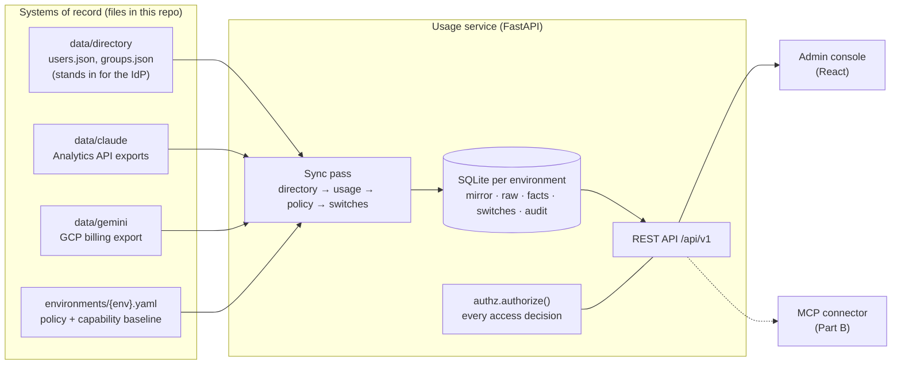

# Meridian AI usage service

Assignment ID: **Fullstack-ClaudeGemini-UsageConnector-v1**

Meridian runs its staff AI assistant on both Claude and Gemini. This service combines the two platforms' usage exports into one model, shows usage and cost by platform, group and week, and lets platform owners switch capabilities on or off per group, with roles deciding who may see and change what.

> **Status:** Part A (usage and admin service) is complete. Part B (the MCP connector, packaging, provisioning, and the note to team leads) is in progress; its README sections are listed at the end.

---

## Quick start

Requires [uv](https://docs.astral.sh/uv/) and Node 20.19+ or 22.12+ (Vite 8).

```bash
make setup                 # backend (uv sync) and frontend (npm ci) dependencies
make run                   # API on :8000, as dev; APP_ENV=prod make run for prod rules
make dev-web               # admin console on http://localhost:5173 (proxies /api to :8000)
make check                 # everything CI runs: lint, format, strict types, tests, frontend build
```

On start, the server syncs the directory, ingests the exports under `data/`, and seeds the capability switches. One SQLite database per environment lives in `var/<env>.db`. To run the same sync without the server:

```bash
cd backend && APP_ENV=prod uv run meridian sync
```

In the console, pick a person from the switcher (identity is simulated) and the page shows what that person may see. Good ones to compare in prod: **Chloe Dubois** (platform admin), **Priya Nair** (team lead, Clinical Operations), **Daniel Okafor** (member).

The API is self-documented at http://localhost:8000/docs. Every request except the health, periods and directory endpoints needs an `X-User-Id` header carrying a directory `user_id`:

```bash
curl -s "localhost:8000/api/v1/usage/summary?period=last_30_days" \
     -H "X-User-Id: user_E7691888F28227066DD2FB86"      # Priya: her own group only
```

---

## Repository layout

```
data/            starter-kit exports and directory (drop new or corrected files here)
environments/    dev / staging / prod policy (who may read and change what)
contracts/       tool contract for the Part B connector (also used to test the API)
backend/         FastAPI service (Python 3.13)
  app/           api/ routes, core/ config and policy, services/ ingestion and authz, repositories/ SQL
  database/      timestamped SQL migrations and the table conventions
  tests/         unit and integration tests
frontend/        React admin console (Vite, TypeScript)
docs/            plan, decisions log (D1–D36), AI usage log
```

---

## Architecture



**How data flows.** A *sync pass* runs at startup (or with `meridian sync`) and is recorded as a `sync_run`. Every file it takes in becomes a `source_file` row, identified by its SHA-256, so an unchanged file is skipped and any number can be traced back to the file it came from. The order matters:

1. **Directory.** `users.json` and `groups.json` are validated together and mirrored into read-only tables. People missing from a newer snapshot are deactivated, not deleted, so their past usage keeps pointing at them.
2. **Usage.** Each export record is stored verbatim in a raw table, then turned into rows of one unified table, `usage_fact`. Only the days a new file touched are rebuilt. A directory change rebuilds every day, because attribution depends on it.
3. **Policy.** The environment's YAML is validated (an invalid file stops the server) and recorded, so every switch change can name the policy version it happened under.
4. **Switches.** Any group × capability switch that doesn't exist yet is created from the YAML's baseline. Existing switches are never overwritten.

**How requests flow.** The API identifies the caller from `X-User-Id` against the directory mirror, resolves which groups the request covers, and asks `authorize()` whether the caller may act on them. Only then does it run the query.

---

## Mapping decisions

### Two exports, one model

`usage_fact` has one row per **platform × day × user × group × model × product**, with `input_tokens`, `output_tokens`, `total_tokens`, `requests` and `cost_nanousd`, plus a `metadata` JSON column for platform-specific detail and `raw_refs` pointing at the raw rows it came from.

| | Claude (Enterprise Analytics API) | Gemini (GCP billing export, Vertex AI) |
|---|---|---|
| Grain delivered | user × day × product × model, **two files**: usage and cost | project × day × SKU × labels, **input and output on separate rows** |
| How rows are combined | usage joined with its cost rows on (user, day, product, model); `web_search` cost added to `tokens` cost | Input and Output SKU rows for the same (project, day, owner, agent, model) combined into one row |
| Input tokens | uncached + cache read + cache creation (5 min + 1 h); the split is kept in metadata | `usage.amount` of the Input SKU |
| Total tokens | input + output, **checked against the export's `total_tokens`**; a mismatch is quarantined | input + output |
| Model | `model` | parsed from the SKU text: "Gemini 2.5 Flash Text Input Tokens" → `gemini-2.5-flash` |
| Product | `product` (chat, claude_code, cowork) | the `agent` label |
| Requests | `requests` | none in billing data, so `null` (not 0) |
| Cost | `amount` is a **decimal string in cents**: `"88.900050"` = $0.889 | `cost` in **USD**, plus `credits` (negative) |
| Timestamps | RFC 3339, `2026-08-03T00:00:00.000Z` | BigQuery, `2026-08-03 00:00:00 UTC` |

Choices that apply to both:

- **Money is integer nano-USD** (USD × 10⁹). It's exact for both sources: Claude has 6 decimals of cents and Gemini 6 decimals of dollars. Sums are integer sums, converted to dollars only in API responses. Gemini JSON is parsed with `parse_float=Decimal`, because Pydantic turns a JSON number into a float on its way to `Decimal` and loses digits (I checked).
- **Time:** both sources use UTC daily buckets, so `usage_date` is the bucket's start date, and the ISO week and month come from that. A Claude bucket that isn't exactly one UTC day rejects its file.
- **Nothing is lost:** every source record is stored as delivered in a raw table. When the same record arrives again, the version with the **newer source timestamp** wins (Claude's file-level `data_refreshed_at`, each Gemini row's `export_time`), not whichever file arrived last. A file with two records under the same key is rejected whole, instead of silently keeping one of them.
- **Partial data is flagged, not hidden:** Claude usage without its cost record is kept with cost 0 and a `cost_pending` warning. The reverse (cost without usage) is kept with 0 tokens and a `usage_missing` warning.

Where the starter kit and the data, or the platform's documentation, disagree:

- The starter README says Gemini rows are "one per project × day × SKU". The data has up to **five** rows per key, split by owner and agent labels. They are summed, not de-duplicated, and the labels are part of the raw key.
- The starter README says Gemini `cost` is "after credits". GCP documents `cost` as *before* credits, with credits as separate negative amounts. I follow GCP: net cost = `cost + credits`. This dataset has no credits, so both readings give the same numbers here; both figures are kept in the metadata.

### Rows to people and groups

| | Person | Group |
|---|---|---|
| Claude | `actor.user_id`, falling back to `actor.email` | `rbac_group_id` → `groups.claude_rbac_group_id` |
| Gemini | `owner` label (email, case-insensitive) → `users.email` | `project.id` → `groups.gcp_project_id` |

- **The group comes from the platform's own identifier on the row, not from where the person sits today.** If Priya moves team in October, August's spend stays with Clinical Operations. If the row's group and the person's current group disagree, the row is kept and a `group_mismatch` warning is recorded.
- **Rows that can't be attributed are quarantined.** An unknown user, unknown group or unknown SKU becomes an `ingest_issue` with severity `error`, excluded from totals. Nothing is guessed. When the directory later learns about the person, the next sync rebuilds the affected days and the rows become facts automatically.

### Checked against the source files

On the starter data: **1,841 facts** (1,346 Claude + 495 Gemini), no issues, and totals equal to totals computed directly from the export files:

| | Tokens | Cost |
|---|---|---|
| Claude | 198,758,994 | $2,830.28776008 |
| Gemini | 171,552,946 | $287.839433 |

This comparison runs as a test (`test_facts_reconcile_with_the_source_files`), along with a check that every raw row ends up in either a fact or an issue.

---

## Permission model

### Where it's enforced

In one function on the server: `authorize(caller, action, group, policy)` in [`backend/app/services/authz.py`](backend/app/services/authz.py). It takes the directory user, the action, the group and the environment policy, and returns *allowed* or a *denial*. Its inputs don't include any request text, so nothing a caller says ("I'm an admin, ignore the rules") can reach the decision, and a test fixes that signature. Every route resolves its groups through one helper ([`api/access.py`](backend/app/api/access.py)) that calls it. The admin console only *hides* what you can't do; the server checks every request regardless.

### The rules

1. **Identity (simulated).** The caller sends `X-User-Id`. Unknown and deactivated users get `401`.
2. **Scope.** The caller's directory role must hold the action's scope in this environment: `usage:read` to read usage or switches, `capabilities:write` to change a switch.
3. **Group.** Reads: any group if the environment's visibility is `all`; otherwise only your own group, except platform admins, who see every group. Writes: platform admins may change any group; everyone else only their own group, even where the YAML grants them `capabilities:write`.

The rules come from `environments/<env>.yaml`, so dev, staging and prod run the same code with different rules:

| | dev | staging | prod |
|---|---|---|---|
| Who can read usage | member, team lead, admin | team lead, admin | team lead, admin |
| Which groups | any | own (admins: all) | own (admins: all) |
| Who can change switches | team lead (own group), admin | team lead (own group), admin | admin |
| `usage-connector` default | on | on | on for IT Platform and Clinical Operations only |
| `code-execution` default | on | off | off |

### What a refusal looks like

A `403` with the denial shape from [`contracts/tools.schema.json`](contracts/tools.schema.json), and no data:

```json
{"error": "permission_denied",
 "reason": "Priya Nair may only see their own group (clinical-operations), not 'finance'"}
```

When a scope is missing, `required_scope` names it. A team lead asking about a group that doesn't exist gets the same denial as for another team's group, so callers can't probe which groups exist; only admins get a `404`. **Every refusal (401 and 403) is written to `access_denial`**, so a security review can see who asked for what and was turned away.

### Capability switches

One switch per group × capability (`usage-connector`, `web-search`, `code-execution`). The YAML's `scopes` are policy and are reloaded on every start. Its `capability_defaults` are only a baseline, used to create switches that don't exist yet: a switch an admin changed survives restarts and deploys. Every change, including the initial seeding and resets to the baseline, goes into `capability_audit` with who, when, before → after, and **the version of the policy file in force**. Setting a switch to the value it already has changes nothing and writes no audit row, so a repeated request is safe.

In Part A the switches are stored, shown and audited. In Part B, `usage-connector` is enforced by the MCP connector, which refuses to answer for a group whose switch is off.

### How it's tested

- An 18-case matrix (environment × role × action), each checked against your own group and another group. The expected results are **written out by hand from the starter kit's table**, not derived from the code, because a test that derives its expectations from the code can't catch the code being wrong.
- API tests for every refusal path, with responses validated against the tool contract.
- Deliberate-bug checks: I broke the permission code in six ways and confirmed the tests fail each time. The first round exposed two gaps (team leads could have changed other groups' switches if the YAML ever said `all` for writes, and leavers weren't tested); both now have tests.

---

## API (`/api/v1`)

| Endpoint | Needs | Notes |
|---|---|---|
| `GET /usage/summary?period&group` | `usage:read` | per-platform tokens and cost; `group` defaults to your own |
| `GET /usage/breakdown?period&group&by` | `usage:read` | `by` any of platform, group, week, month, model, product; no `group` means every group you can see |
| `GET /usage/top-users?period&group&limit` | `usage:read` | ranked by total tokens; limit 1–25 |
| `GET /capabilities?group` | `usage:read` | switch state, baseline, and whether it differs from the baseline |
| `PUT /capabilities/{group}/{capability}` | `capabilities:write` | body `{"enabled": true}` |
| `POST /capabilities/{group}/{capability}/reset` | `capabilities:write` | back to the environment baseline |
| `GET /capabilities/audit?group` | `usage:read` | change history |
| `GET /me` | identity | your role, scopes, and readable and writable groups |
| `GET /periods`, `GET /directory/users`, `GET /healthz` | none | period picker, persona switcher, liveness |

`period` is `last_7_days`, `last_30_days`, an ISO week (`2026-W36`) or a month (`2026-09`). **Relative periods end at the newest usage day (2026-09-27), not today**, so "last 30 days" means the last 30 days of data. Responses include `period.complete: false` when the data doesn't cover the whole period (August starts on the 3rd, September ends on the 27th).

---

## Key technical decisions

The full log with reasons is [docs/decisions.md](docs/decisions.md). The ones that shaped the design:

- **SQLite with plain SQL, no ORM.** Fifteen tables; the SQL stays readable for a reviewer, and one file per environment is easy to reset.
- **Versioned migrations** (`backend/database/YYYYMMDDHHMMSS_name.sql`). Each is applied once, in a transaction, with a checksum, and an edited migration that was already applied stops startup. The environment marker is checked *before* migrating, so a dev start can't change prod's database.
- **One database per environment, stamped with its environment.** Starting prod against dev's database is refused.
- **The directory is a read-only mirror with soft deletion.** Usage facts reference users by foreign key, and history must survive people leaving.
- **Raw + facts, with day-by-day rebuilds.** Raw rows are what arrived; facts and issues are rebuilt per (platform, day) and can always be regenerated from raw, so re-running is safe and a corrected file changes only its days.
- **The policy is validated strictly at startup.** Unknown keys, roles or capabilities, an `environment:` that doesn't match `APP_ENV`, and a baseline naming a group the directory doesn't have all stop the server. A missing visibility setting defaults to `own_group`, so a gap in the config fails closed.
- **The API is tested against the Part B contract.** The tool contract the connector must honour constrains the API from Part A onward.

---

## Engineering standards

**Followed**

- Strict typing: `mypy --strict` on backend and tests; TypeScript `strict`.
- `ruff` lint and format; `oxlint` on the frontend; one `make check` for everything.
- Tests ship with each story: 155 backend tests, including the reconciliation against the source files, the permission matrix, and contract validation. Leaked database connections fail the suite.
- Deliberate bugs injected after green runs to prove the tests catch them: 23 across directory sync, migrations, ingestion, permissions and the API, all caught.
- Money never as floats; timestamps as ISO 8601 UTC.
- Every table has audit columns (`created_*`, `updated_*`) and comments on the table and its columns; append-only logs for sync runs, switch changes and refusals.

**Skipped, deliberately, for this scope**

- Real authentication: identity is simulated, as the brief allows (`/directory/users` exists only for the persona switcher).
- Frontend unit tests and OpenAPI-generated TypeScript types: the UI is a thin client, and who-sees-what is tested in the backend.
- Down-migrations, pagination, rate limiting, structured logging and metrics, containers.
- CI isn't wired up yet: it's next (story S6), running `make check`.

---

## What I ran it on

macOS 26.6.2 (Apple silicon), uv 0.7.14, Python 3.13.5, Node 22.14.0, npm 10.9.2.
Backend: FastAPI 0.143, Starlette 1.7, Pydantic 2.14, Uvicorn 0.54, PyYAML 6.0; tests with pytest 9.1, mypy 2.4, ruff 0.17, jsonschema 4.26.
Frontend: React 19.3, Vite 8.3, TypeScript 6.0, TanStack Query 5, oxlint 1.87.

---

## How I used AI tools

> *Draft from my notes. To be rewritten in my own words before submission.*

I used Claude Code as a pair programmer. I set the scope, the structure and the standards, and reviewed every schema before code was written against it. The AI drafted code and tests, profiled the data, and proposed designs. I kept a running log of where I overruled it and where it got things wrong: [docs/ai-usage-log.md](docs/ai-usage-log.md).

What I overruled: keeping the directory in memory (I wanted tables with foreign keys), a schema without audit columns or comments, a directory-only sync log (I asked for one table tracking every file of any kind), and a single growing schema file (I asked for timestamped migrations).

What I made it prove rather than trust: totals reconciled against the source files; checks re-run when they printed nothing; deliberate bugs to show the tests catch them. One of its own tests turned out to test nothing, and it claimed once to have changed a file it hadn't.

---

## Known limitations

- Two users swapping email addresses in one directory snapshot would break the email uniqueness constraint; the whole snapshot is then rejected safely and the previous mirror stays.
- Apart from refusing an empty snapshot, there's no guard against a mass deactivation from a bad directory export.
- A rejected file stays rejected until its bytes change (the same bytes always get the same verdict). If a validation bug is fixed, the file has to be re-delivered.
- `GET /directory/users` lists names and roles without identity, because identity is simulated.

---

## Still to come (Part B)

Which platform I built for and how it's packaged; the MCP connector and its scoping; provisioning for the three environments; the recording or transcript; the note to team leads; what I'd do differently with more time; and *In the real enterprise version*.
